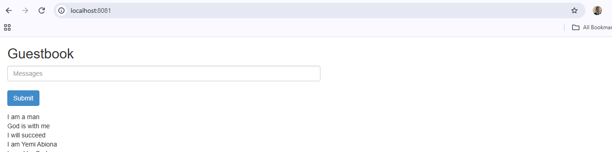
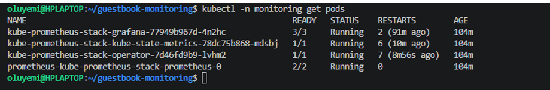
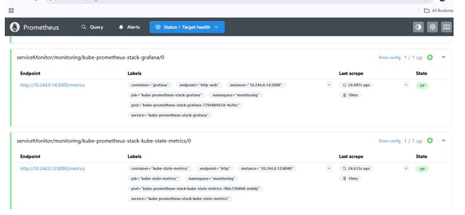
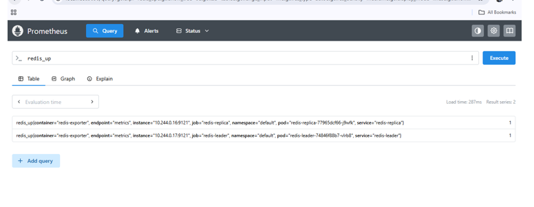
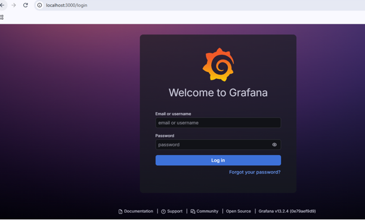
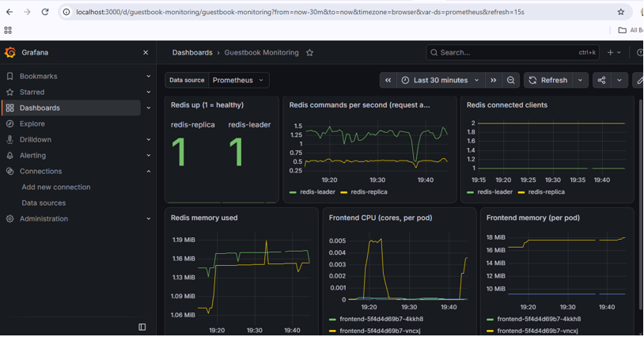
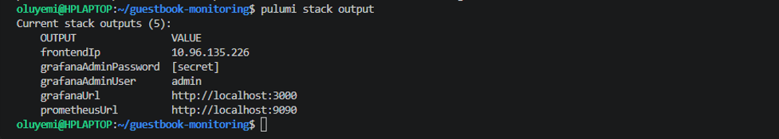

# Guestbook Monitoring (Pulumi + Prometheus + Grafana)

Extends Pulumi's Guestbook example (`pulumi/examples`, `kubernetes-ts-guestbook`, `simple` variant) with
Prometheus and Grafana monitoring, all deployed with Pulumi (TypeScript) to a local kind cluster.
The Guestbook app itself comes from Pulumi's public example; see that repository for its licence.

## What gets deployed
- **Guestbook:** frontend (3 replicas), `redis-leader`, `redis-replica` (Redis pinned to 7.2)
- **Monitoring:** `kube-prometheus-stack` Helm chart 92.14.1 (Prometheus, Grafana, Prometheus Operator, kube-state-metrics)
- **Scraping:** `redis_exporter` sidecars on both Redis pods, plus a `ServiceMonitor` for each
- **Access:** Grafana on NodePort 30300 (localhost:3000), Prometheus on NodePort 30090 (localhost:9090)
- **Dashboard:** "Guestbook Monitoring", loaded automatically from a ConfigMap

## Requirements coverage
| Requirement | How it is met |
|---|---|
| Deploy Prometheus and Grafana with Pulumi | Helm release in `monitoring.ts` (Pulumi `helm.v3.Release`) |
| Prometheus scrapes frontend and backend | Backend: `ServiceMonitor`s for the Redis exporters. Frontend: pod CPU/memory from the kubelet (cAdvisor) target that the stack scrapes |
| Simple metrics (requests / resource usage) | Redis commands per second, Redis memory/clients, frontend CPU and memory per pod |
| Expose Grafana (LoadBalancer or NodePort) | NodePort 30300, mapped to localhost:3000 by `kind-config.yaml` |
| Output Grafana URL and credentials | Pulumi stack outputs `grafanaUrl`, `grafanaAdminUser`, `grafanaAdminPassword` (secret) |
| Stretch: dashboard | `dashboards/guestbook-dashboard.json`, provisioned as a ConfigMap |

## Prerequisites (versions I tested with)
Docker Engine 29.9.2 (inside WSL 2, Ubuntu 24.04), kind v0.33.0, kubectl v1.37.2, Node.js v24.22.2 (npm 11.19.1),
Pulumi v3.273.0, Git 2.43.0. Helm v3.22.1 was only used to look up chart versions.
Resources used: 2 CPUs and 8 GB RAM available to Docker. A Pulumi account (free) or `pulumi login --local`.

## Deploy
```bash
git clone https://github.com/yemabion/guestbook-monitoring.git guestbook-monitoring && cd guestbook-monitoring
kind create cluster --name guestbook --config kind-config.yaml
kubectl config current-context        # should print: kind-guestbook
npm ci
pulumi login                          # or: pulumi login --local
pulumi stack init dev
pulumi config set isMinikube true     # kind has no cloud LoadBalancer, so the frontend uses ClusterIP
pulumi config set grafanaHost localhost
pulumi config set grafanaPort 3000
pulumi config set --secret grafanaAdminPassword    # prompts for a password of your choice (input hidden)
pulumi up
```
The first `pulumi up` is slow on a small machine (about 16 minutes on my 2-CPU laptop) because many images are pulled.
`kind-config.yaml` must be used when creating the cluster: it maps host ports 3000 and 9090 to the NodePorts.

## Access
| Service | URL | Username | Password |
|---|---|---|---|
| Grafana | http://localhost:3000 | `admin` | the password you entered at the `pulumi config set --secret` prompt |
| Prometheus | http://localhost:9090 | none | none |

`pulumi stack output` prints the URLs and username. Reveal the password with
`pulumi stack output grafanaAdminPassword --show-secrets`.
To open the Guestbook itself: `kubectl port-forward svc/frontend 8081:80`, then http://localhost:8081.

## How to verify Guestbook metrics are scraped by Prometheus
1. Open http://localhost:9090/targets and filter for `redis`. Expect `serviceMonitor/monitoring/redis-leader/0` and
   `serviceMonitor/monitoring/redis-replica/0`, each **1 / 1 up**.
2. In the Query tab, run:
   - `redis_up` returns 2 series with value 1
   - `rate(redis_commands_processed_total[1m])` returns request activity per Redis
   - `container_memory_working_set_bytes{namespace="default", pod=~"frontend.*", container="frontend"}` returns 3 series (one per frontend pod)
3. Generate traffic: port-forward the frontend (above) and add entries; the command rate rises.
4. CLI check: `kubectl get servicemonitor -n monitoring | grep redis` and `kubectl get endpoints redis-leader` (port 9121 listed).
5. Dashboard: Grafana > Dashboards > **Guestbook Monitoring**.

## Screenshots








## Design decisions and trade-offs
- **kube-prometheus-stack via Helm:** a tested bundle (operator, CRDs, Prometheus, Grafana, kube-state-metrics) is faster and less error-prone than hand-written manifests. Trade-off: less visibility into every part, so I pinned the chart version and override only what I need.
- **Trimmed for a small local cluster:** Alertmanager, node-exporter, the default rules and dashboards, and the etcd/scheduler/controller-manager/kube-proxy scrape targets are disabled. On kind those control-plane targets show as permanently down.
- **ServiceMonitors:** the operator finds scrape targets declaratively by Service label and port name, with no manual Prometheus config. I set `serviceMonitorSelectorNilUsesHelmValues: false` so Prometheus selects them.
- **Exporter sidecars:** Redis does not expose Prometheus metrics itself. `redis_exporter` runs beside each Redis container (shared network, `localhost:6379`) and exposes them on port 9121.
- **NodePort plus kind port mapping:** simplest option for a local cluster; the mapping must exist when the cluster is created.
- **Secrets and config:** the Grafana password is a Pulumi secret config value, never in code. `Pulumi.dev.yaml` is git-ignored; `Pulumi.dev.yaml.example` shows the shape.
- **Explicit names and labels, pinned versions:** the upstream example relied on auto-generated names and unpinned images; explicit labels are what the ServiceMonitors select on.

## Issues found along the way
- **Entries vanished after refresh.** The replica log showed `Can't handle RDB format version 15`: the leader used an unpinned (new) `redis` image while the replica used an old custom image, so replication failed. Fix: both now use `redis:7.2`, the replica started with `--replicaof redis-leader 6379`. Verified with `info replication` (link up, one connected replica).
- **Pulumi Cloud returned a transient 504** during one `pulumi up`; re-running succeeded.
- **Monitoring pods restarted several times** during my first ~2 hours on a 2-CPU laptop (operator: 8 restarts, kube-state-metrics: 6). Neither was OOMKilled. Pod events show liveness/readiness probes timing out ("context deadline exceeded"), so Kubernetes restarted them; this is consistent with CPU starvation on a small machine (I did not measure CPU). All pods returned to Ready, and Prometheus targets and the dashboard kept working, with small gaps in some graphs. On a machine with more CPU I would expect far fewer restarts; the next step would be to raise the probe timeouts or resource requests.

## Limitations
- The stock frontend exposes no Prometheus metrics, so there is **no true HTTP request rate or error rate**. Frontend health is shown through resource usage; Redis command rate is a proxy for application activity, not the same thing.
- No persistence: Redis data is lost when its pods restart; Prometheus keeps 12 hours of data on ephemeral storage.
- No alerting, TLS or SSO; Grafana uses a documented demo password. Single-node kind cluster, no high availability.
- The frontend image (`pulumi/guestbook-php-redis`) is not version-pinned.

## Next steps
Instrument the frontend (or add a blackbox probe) for request, latency and error metrics; add alert rules and Alertmanager;
persistent volumes for Prometheus and Redis; Ingress with TLS and SSO for Grafana; CI running `pulumi preview`.

## Cleanup
```bash
pulumi destroy
kind delete cluster --name guestbook
```